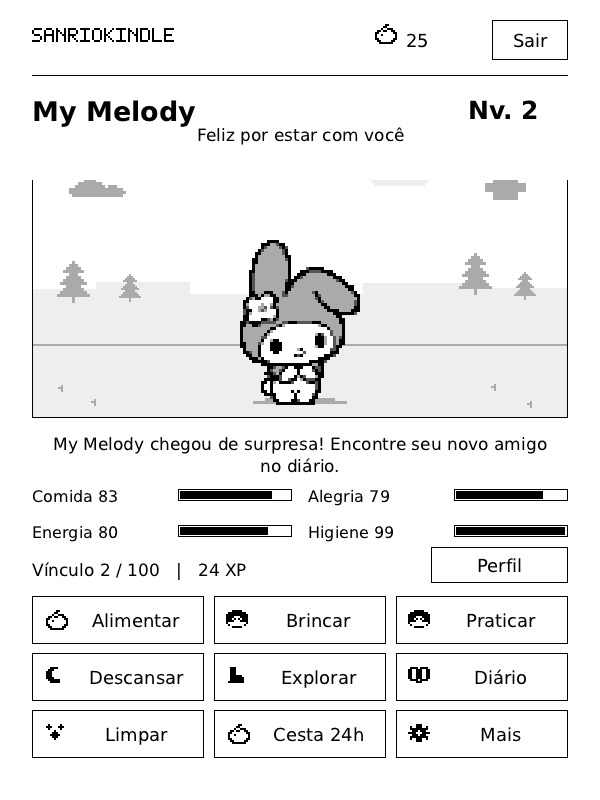
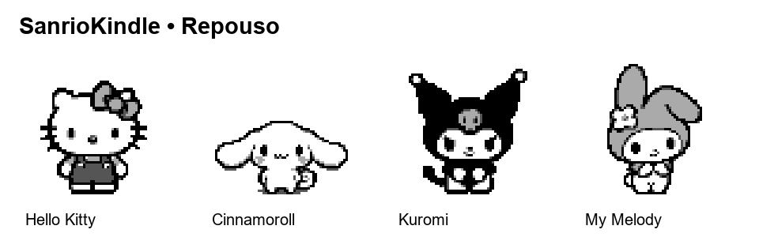

# Sanrio-For-Kindle

Amigos da Sanrio para suas pausas de leitura no Kindle, inspirado no PokeK. Interface e instruções em português brasileiro; funcionamento offline.



**Hello Kitty, Cinnamoroll, Kuromi e My Melody — tudo em PT-BR.**

[Baixar a versão 0.1.0](https://github.com/paulor8bit/Sanrio-For-Kindle/releases/tag/v0.1.0) · [Projeto original](https://github.com/itsParassharma/Pokepal-for-Kindle)

## Primeira edição — 0.1.0

- Hello Kitty, Cinnamoroll, Kuromi e My Melody disponíveis desde o início.
- 72 quadros originais: 18 por personagem, com repouso, caminhada, brincadeira, alimentação e sono.
- Sprites de 64 × 64 pixels, transparência real e quatro tons de cinza. Ampliação sem suavização na preparação das artes.
- Alimentação, brincadeiras, prática de atividades, descanso, higiene, decoração e diário de amigos.
- Passeios no Jardim dos Laços, Caminho das Nuvens e Trilha do Luar.
- Presentes que ficam prontos com a leitura, níveis de amizade, metas semanais e conquistas.
- Preferências de contraste, tamanho do texto, rodapé de leitura e tela de descanso do KOReader.
- Dados separados em `/mnt/us/sanriokindle/sanriokindle.dat`, sem importar os dados do PokeK.

## Instalar no KOReader

É necessário ter KOReader instalado no Kindle.

1. Descompacte `dist/SanrioKindle-v0.1.0-koreader.zip`.
2. Copie a pasta `koreader` para a unidade do Kindle, mesclando com a existente.
3. Reinicie o KOReader.
4. Abra **Ferramentas → Mais ferramentas → SanrioKindle — Amigos de leitura**.

Alternativamente, copie `sanriokindle.koplugin` para `koreader/plugins/`.

## Instalar com KUAL (sem KOReader)

É necessário ter um Kindle com desbloqueio e KUAL instalado.

1. Baixe e descompacte **SanrioKindle-v0.1.0-kual.zip** na página de versões.
2. Copie a pasta `extensions` para a unidade do Kindle, ao lado de `documents`.
3. Ejete o Kindle e abra **KUAL → SanrioKindle PT-BR → Jogar SanrioKindle**.

As edições KUAL e KOReader compartilham o progresso pela pasta `sanriokindle`. Para instalar, use apenas o pacote da edição desejada.

O código, as telas e a execução nativa foram validados no computador; ainda falta o teste em um Kindle físico.

## Downloads

Na [página de versões](https://github.com/paulor8bit/Sanrio-For-Kindle/releases/latest):

- **kual.zip**: instalação independente pelo KUAL.
- **koreader.zip**: plugin para KOReader.
- **artes.zip**: cartelas originais, sprites individuais e prévias.
- **fontes.zip**: código e dependências correspondentes ao executável, incluindo os avisos de licença.
- **SHA256.txt**: verificação dos arquivos.

## Artes

- `artes/originais/`: quatro cartelas geradas, preservadas com transparência.
- `artes/sprites/`: 72 PNGs individuais com nomes de poses em português.
- `artes/catalogo.json`: relação de personagens e arquivos.
- `artes/PROMPTS.md`: prompts completos utilizados com a ferramenta integrada de geração de imagens.
- `artes/previa-personagens.png`: visão geral das cinco poses.
- `docs/previa-jogo.png`: quatro telas reais da interface, renderizadas a partir do código Lua.
- `artes/previa-animada.gif`: prévia dos movimentos dos quatro amigos.

O motor mantém nomes internos de poses compatíveis com o projeto de origem, inclusive `attack` para a brincadeira, sem combate. Os ícones e cenários em pixels são reaproveitados da base; o presente substitui o ovo e os personagens não se transformam uns nos outros.

## Verificar e preparar o pacote

Com Python e as dependências de `requirements-dev.txt` instalados:

```text
python tools/prepare_sprites.py
python tests/test_sanrio.py
python tools/build_native.py --zig /caminho/zig --deps /caminho/dependencias
python tools/package_release.py --deps /caminho/dependencias
```

Os testes verificam os quatro personagens, os quadros empacotados, alimentação, leitura, presentes, passeios, conquistas, salvamento, animações limitadas e telas em três tamanhos. A renderização usa a interface Lua real com substitutos locais dos componentes do KOReader; não simula o sistema operacional do Kindle.



## Créditos

Base de código: PokeK/PokePal for Kindle, de itsParassharma e colaboradores, sob licença MIT preservada em `sanriokindle.koplugin/LICENSE-CODE.txt`. As artes dos personagens foram criadas para esta adaptação com geração de imagens. Hello Kitty, Cinnamoroll, Kuromi e My Melody pertencem à Sanrio. Projeto de fã não oficial, sem afiliação à Sanrio.

Este repositório possui histórico próprio para o SanrioKindle. O projeto Pokepal-for-Kindle-PTBR permanece separado e preservado.
